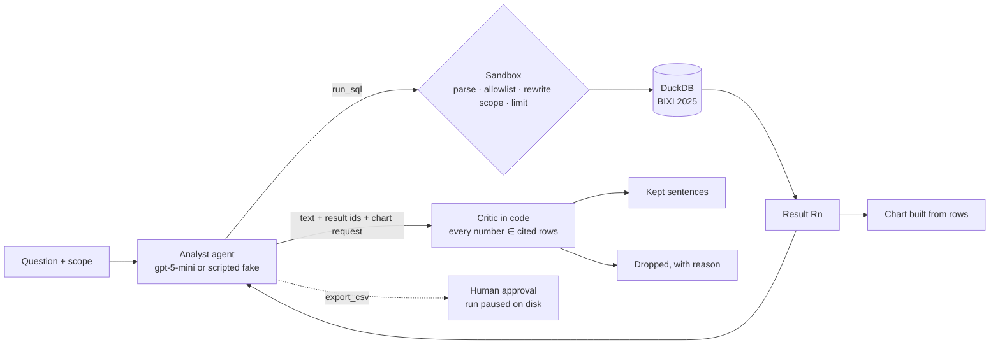

# mtl-analyst-agent

[](https://github.com/waland1510/mtl-analyst-agent/actions/workflows/ci.yml)

An analyst agent over Montréal open data (BIXI bike-share trips, 2025),
in Python on the Microsoft Agent Framework. The model writes SQL; it never
runs it. Every query goes through a sandbox that rewrites the AST to
inject the caller's row-level scope, allows only catalog reads, and
enforces a query count and a timeout. The numbers in an answer are checked
by code against the rows that actually came back.

Sibling of [condo-agents](https://github.com/waland1510/condo-agents)
(.NET, retrieval over documents). Same posture, different question: there
the model drives control flow; here it writes code.

Status: steps 1 to 6 and 8 of the [plan](docs/plan.md) are done on the
scripted fake; Azure mode (step 7) is next.



## Run

```bash
python3.13 -m venv .venv && . .venv/bin/activate
pip install -e ".[dev]"
pytest -q                                   # 54 tests, no network: the data is checked in
python -m mtl_analyst evals                 # 7 cases, writes evals/results/latest.md
python -m mtl_analyst ask "Which borough was the busiest in 2025?"
python -m mtl_analyst ask --borough "Ville-Marie" "Which borough was the busiest?"   # sees only itself
python -m mtl_analyst serve                 # http://127.0.0.1:8000 — ask, watch SQL and rows, approve
```

## Reading guide

1. [ADR 3](docs/adr/0003-numbers-are-verified-by-code-against-returned-rows.md)
   and [answer.py](src/mtl_analyst/answer.py): a sentence survives only if
   every number in it is in a result it cites. The test suite includes a
   model that lies about a total.
2. [ADR 2](docs/adr/0002-scope-is-rewritten-into-the-sql-ast.md) and
   [sandbox.py](src/mtl_analyst/sandbox.py): the boundary is the rewritten
   AST. [test_sandbox.py](tests/test_sandbox.py) asks for other boroughs by
   name and gets nothing.
3. [ADR 4](docs/adr/0004-sandbox-rejections-and-budgets-end-the-run.md)
   and [runtime.py](src/mtl_analyst/runtime.py): budgets in middleware,
   and why a rejected statement ends the run instead of being retried.
4. [orchestrator.py](src/mtl_analyst/orchestrator.py): one agent, the
   critic, the chart, the approval pause and the file-backed run.
5. [evals/results/latest.md](evals/results/latest.md): cases graded on
   status, tools, scope leakage and whether the golden SQL's value appears
   in a kept sentence.
6. [catalog.py](src/mtl_analyst/catalog.py): the only three tables the model
   can name, and the text it is told about them.
7. [data/README.md](data/README.md): where the data comes from and how the
   three small files were derived from the 2.8 GB export.
